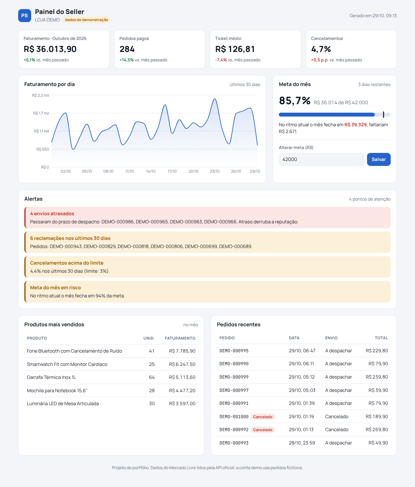

# Painel do Seller

Painel para quem vende no Mercado Livre: faturamento, metas e alertas da loja em um só lugar, com os dados lidos pela API oficial do Mercado Livre.



## O que ele faz

- **Indicadores do mês:** faturamento, pedidos pagos, ticket médio e taxa de cancelamento, comparados com o mesmo período do mês anterior.
- **Faturamento por dia:** gráfico dos últimos 30 dias.
- **Meta do mês:** progresso, projeção no ritmo atual e quanto falta. A meta é editável no próprio painel.
- **Alertas automáticos:**
  - envios que passaram do prazo de despacho;
  - reclamações (mediações) nos últimos 30 dias;
  - cancelamentos acima de 3%;
  - meta do mês em risco.
- **Produtos mais vendidos** e **pedidos recentes**.
- **Conta demo** com cerca de 1.000 pedidos fictícios, regenerada todo dia, para o painel funcionar sem uma conta do Mercado Livre.

## Tecnologias

- [Next.js 15](https://nextjs.org/) (App Router, Server Components e Server Actions)
- [Prisma](https://www.prisma.io/) + PostgreSQL
- [Recharts](https://recharts.org/) para o gráfico
- API do Mercado Livre: OAuth 2.0, `/orders/search` e `/shipments`
- Deploy no [Railway](https://railway.app/)

## Como funciona a integração

1. **Conectar:** o vendedor clica em "Conectar Mercado Livre" e autoriza o app (OAuth 2.0 com `state` contra requisições forjadas).
2. **Salvar tokens:** o app troca o código pelos tokens, salva a conta e cria uma sessão com um token aleatório guardado num cookie `httpOnly`.
3. **Sincronizar:** busca os pedidos dos últimos 90 dias e os dados de envio de cada um, e grava tudo no banco.
4. **Renovar:** o *access token* dura 6 horas e é renovado automaticamente com o *refresh token*.

Arquivos principais:

| Arquivo | Função |
| --- | --- |
| `src/lib/ml.js` | Cliente da API do Mercado Livre (OAuth, renovação de token, sincronização) |
| `src/lib/metrics.js` | Cálculo dos indicadores, da meta, dos alertas e dos rankings |
| `src/lib/demo.js` | Gerador da conta demo |
| `src/app/page.js` | Tela do painel |
| `prisma/schema.prisma` | Modelo do banco |

## Rodando localmente

Pré-requisitos: Node.js 20 ou mais novo e um PostgreSQL.

```bash
npm install
cp .env.example .env        # ajuste o DATABASE_URL
npx prisma migrate deploy   # cria as tabelas
npm run db:seed             # opcional: a conta demo também é criada no primeiro acesso
npm run dev
```

Abra http://localhost:3000.

## Conectando uma conta do Mercado Livre

1. Crie um app em [developers.mercadolivre.com.br](https://developers.mercadolivre.com.br/devcenter).
2. Em **URI de redirect**, coloque `https://SEU-DOMINIO/api/ml/callback`.
3. Preencha `ML_CLIENT_ID`, `ML_CLIENT_SECRET` e `ML_REDIRECT_URI` no `.env`.
4. Para testar sem vender de verdade, crie [usuários de teste](https://developers.mercadolivre.com.br/pt_br/realizacao-de-testes).

## Deploy gratuito (Vercel + Neon)

1. Em [vercel.com](https://vercel.com), entre com o GitHub e importe este repositório.
2. No projeto, abra **Storage** → **Create Database** → **Neon** (Postgres gratuito). A Vercel cria a variável `DATABASE_URL` sozinha.
3. Faça um novo deploy (**Deployments** → **Redeploy**). O `build` aplica as migrações e cria as tabelas.
4. Para conectar o Mercado Livre, adicione `ML_CLIENT_ID`, `ML_CLIENT_SECRET` e `ML_REDIRECT_URI` em **Settings** → **Environment Variables**.

## Deploy no Railway

1. Crie um projeto com um serviço **PostgreSQL** e um serviço a partir deste repositório.
2. No serviço do app, configure as variáveis:
   - `DATABASE_URL`: referência ao Postgres;
   - `ML_CLIENT_ID`, `ML_CLIENT_SECRET` e `ML_REDIRECT_URI`.
3. O Railway roda `npm run build` e `npm start`. O `start` aplica as migrações antes de subir.

## Próximos passos

- [ ] Notificações em tempo real do Mercado Livre (webhooks) no lugar da sincronização manual
- [ ] Metas por produto e por colaborador
- [ ] Alertas por e-mail ou WhatsApp
- [ ] Outras fontes: Shopee, Amazon e ERPs como o Tiny
